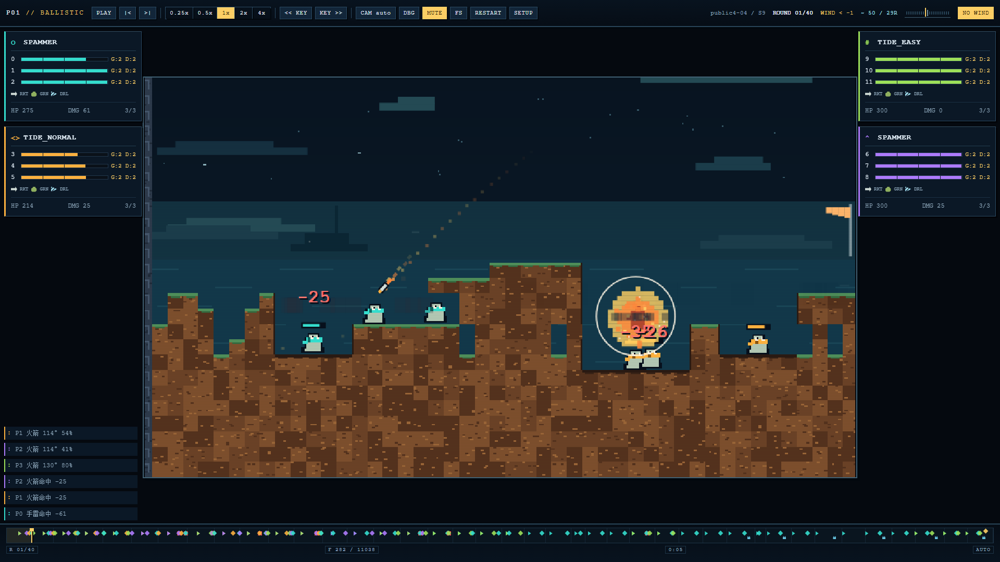

# P01 BALLISTIC 像素观战器

把 P01 BALLISTIC（弹道虫，4 席回合制定点弹道对战题）的对局做成可回放、可逐帧、可给 Remotion 逐帧采样的像素风观战程序。



- `server/`：Python 3 标准库写的本地 HTTP 服务和对局 runner，带一份加了旁路事件日志的引擎拷贝。
- `web/`：vanilla JS + Canvas2D 前端，无依赖、无外链、无构建步骤。
- `traces/samples/`：一局样例对局，不需要任何额外文件即可播放。

## 快速开始

### 1. 仅回放（不需要题目包）

本仓库不附带地图、裁判和任何 bot 二进制。没有配置题目包时，服务以“仅回放”模式启动，可以播放 `traces/samples/` 里的样例，不能跑新对局。

```bat
python server\app.py
```

浏览器会自动打开 <http://127.0.0.1:8765/>（加 `--no-open` 可不打开）。在首页的样例列表里选 `demo-4seat` 即可播放。

也可以直接用 URL 打开样例：

```text
http://127.0.0.1:8765/?trace=/traces/samples/demo-4seat.json
```

### 2. 配置题目包，跑新对局

跑新对局需要另外取得 P01 题目包（p01-ballistic 选手包）：它在 [Aesolumitria-ai-arena](https://github.com/Aesolumitria-Lab/Aesolumitria-ai-arena) 仓库的 `packages/p01-ballistic/` 目录下。解压后其目录下应有 `public/maps4`、`public/baselines/bin` 等。用环境变量或命令行参数把它指给程序。

命令行参数：

```bat
python server\app.py --game C:\path\to\p01-ballistic
```

或环境变量（cmd）：

```bat
set P01_GAME=C:\path\to\p01-ballistic
python server\app.py
```

或环境变量（PowerShell）：

```powershell
$env:P01_GAME = "C:\path\to\p01-ballistic"
python server\app.py
```

启动后在首页选地图、seed 和 4 个 bot，点 **START MATCH**，生成的 trace 会写到 `server/traces/` 并自动播放。默认 bot 组合是 `tide_hard` / `tide_normal` / `tide_easy` / `random4`。

可选：把你自己的 bot 源码目录也加进来。

```bat
python server\app.py --game C:\path\to\p01-ballistic --submissions C:\path\to\my-bots
```

`--submissions` 可重复；环境变量 `P01_SUBMISSIONS` 可放多个目录，用系统路径分隔符隔开（Windows 为 `;`，Linux 为 `:`）。每个根目录下的每个子目录，如果其中有 `submission.cpp`（或再下一层子目录里有 `submission.cpp`），就会被 `g++` 编译成一个可选 bot，id 为子目录名。编译失败的 bot 在列表里标为未就绪，不影响其他功能。

演示 bot `spammer`、`crasher` 只带源码（`server/demo_bots/`），首次用到时由服务编译到 `server/cache/bots/`，编译需要题目包里的 `arena4.hpp`。

`scripts\start.bat` 只是 `python server\app.py` 的包装，参数原样透传。`scripts\build_all.bat` 预先编译 trace 引擎（不执行也行，服务启动时会自动编译）。

### 服务参数

| 参数 | 默认 | 说明 |
|---|---|---|
| `--port` | `8765` | 监听端口 |
| `--host` | `127.0.0.1` | 监听地址，见下面的安全提示 |
| `--no-open` | 关 | 不自动打开浏览器 |
| `--game DIR` | 读 `P01_GAME` | P01 题目包目录 |
| `--submissions DIR` | 读 `P01_SUBMISSIONS` | bot 源码根目录，可重复 |

## 操作

| 键 | 作用 |
|---|---|
| `Space` | 播放 / 暂停 |
| `←` / `→` | 上一帧 / 下一帧（`Shift` ×10） |
| `[` / `]` | 减速 / 加速 |
| `D` | 调试叠加（网格/坐标/tick/hash/FPS） |
| `U` | 隐藏 UI（纯净画面） |
| `F` | 全屏 |
| `M` | 静音 |
| `R` | 重播 |

另外还有：`,` / `.` 上一个 / 下一个关键事件，`PageUp` / `PageDown` 跳轮，`Home` / `End` 跳到开头 / 结尾，`C` 切换相机，`1`-`4` 跟随对应席位，`Esc` 返回设置页；画布上滚轮缩放、拖拽平移（进入手动相机）。

默认开启音效（浏览器要求先点一下页面或按任意键才能出声）；`M` 或顶栏按钮切换，偏好记在 localStorage；`?muted=1` 强制静音。

## URL 参数与 Remotion 入口

| 参数 | 说明 |
|---|---|
| `trace=<url>` | 直接载入某个 trace，例如 `/traces/samples/demo-4seat.json` |
| `frame=<n>` | 载入后跳到第 n 帧并停住 |
| `autoplay=0` / `1` | 是否自动播放 |
| `ui=0` | 隐藏 HUD，只留画布 |
| `debug=1` | 打开调试叠加 |
| `camera=full` | 相机模式：`full` / `auto` / `follow:<seat>` / `manual` |
| `speed=<x>` | 播放速度 |
| `muted=1` | 强制静音 |
| `bg=<css 颜色>` | 设置页面背景色变量（画布本身不透明） |

页面上还暴露了 `window.__P01V__`，可以逐帧驱动和截图：

```js
await window.__P01V__.ready;
await window.__P01V__.loadTrace("/traces/samples/demo-4seat.json");
window.__P01V__.seekFrame(1234);
const png = window.__P01V__.capture(); // dataURL
```

完整的 API 和 Remotion 接入示例见 [remotion/README.md](remotion/README.md)。

## 目录结构

```text
server/
  app.py            本地 HTTP 服务与 /api
  runner.py         跑一局并拼装 trace JSON（也可单独命令行使用）
  catalog.py        地图 / bot / 样例目录，题目包配置
  trace_engine/     带旁路事件日志的引擎拷贝（C++），来源见 UPSTREAM.md
  demo_bots/        演示 bot 源码（spammer、crasher）
web/                前端（vanilla JS + Canvas2D）
  js/core/          trace 载入、帧烘焙、渲染循环、相机、输入、HUD 骨架
  js/visual/        图层、特效、HUD 皮肤、程序化音效
  js/shared/        共享常量
traces/samples/     样例对局与索引
scripts/            build_all.bat、start.bat、verify_traces.py
remotion/           Remotion 接入说明
docs/               架构、trace 格式、帧契约、视觉规范
```

## 环境要求

- Python 3.11+，只用标准库，不需要 pip 包。
- g++（MinGW，支持 C++17）：用于编译 trace 引擎和 bot；编译结果有缓存。仅回放模式下服务启动时也会尝试编译引擎，失败只打印警告，不影响回放。
- 现代浏览器（Chrome / Edge）。
- 不联网，不需要 npm。

平台说明：本项目在 Windows 11 + MinGW-w64 g++ + Python 3.12 上验证过。代码里对 Linux 做了适配（可执行文件后缀、题目包里的 `bin/linux` 目录），但没有在 Linux 上测试过。

## 自检

校验脚本需要配置题目包。它把 `traces/samples/index.json` 里的每个样例用相同的地图、seed、bot 重新跑两遍，比较逐轮 `state_hash` 和最终 hash 是否一致：

```bat
python scripts\verify_traces.py --game C:\path\to\p01-ballistic
```

如果你另外有题目包裁判（`judge4`）用 `--replay-dir` 导出的回放文件，还可以逐轮对照：

```bat
python scripts\verify_traces.py --game C:\path\to\p01-ballistic --replay-dir C:\path\to\replays
```

回放文件需要命名为 `<map>-seed<seed>-perm*.jsonl`。

视觉层带一个不依赖浏览器的 Node 自测（用插桩 Canvas，检查绘制参数合法和 seek 一致性，不检查真实像素、音频和帧率）：

```bat
node --experimental-default-type=module web\js\visual\selftest.mjs
```

## 引擎拷贝与许可

本项目以 Apache-2.0 发布，见 [LICENSE](LICENSE) 和 [NOTICE](NOTICE)。

`server/trace_engine/` 里的 `engine_trace.cpp` 和 `trig.hpp` 是 P01 BALLISTIC 题目公开引擎的拷贝，`engine_trace.cpp` 只增加了旁路事件日志，不改变模拟、状态哈希和判罚逻辑。来源、版本、改动说明和核对方法见 [server/trace_engine/UPSTREAM.md](server/trace_engine/UPSTREAM.md)。

trace 的 `meta.engine_hash` 是 `engine_trace.cpp` 源码的 sha256 前 16 位，`meta.engine_upstream` 记录所基于的上游引擎版本。

## 安全提示

`POST /api/run` 会在本机编译并执行 bot 程序。服务默认只监听 `127.0.0.1`，请不要用 `--host 0.0.0.0` 把它暴露到不受信任的网络。同样，`--submissions` 指向的目录里的代码会被编译并运行，只放你信任的源码。

## 文档

- [docs/ARCHITECTURE.md](docs/ARCHITECTURE.md)：整体架构、数据流、HTTP API
- [docs/TRACE_FORMAT.md](docs/TRACE_FORMAT.md)：trace JSON（`p01viz/1`）字段说明
- [docs/FRAME_CONTRACT.md](docs/FRAME_CONTRACT.md)：前端帧与视觉层契约
- [docs/VISUAL.md](docs/VISUAL.md)：视觉规范与实现说明
- [remotion/README.md](remotion/README.md)：逐帧渲染接入

## 定位

本程序只做观战和调试，不做排位，也不做裁判。局面的权威状态来自引擎拷贝，前端只消费 trace，不自行判定胜负。
